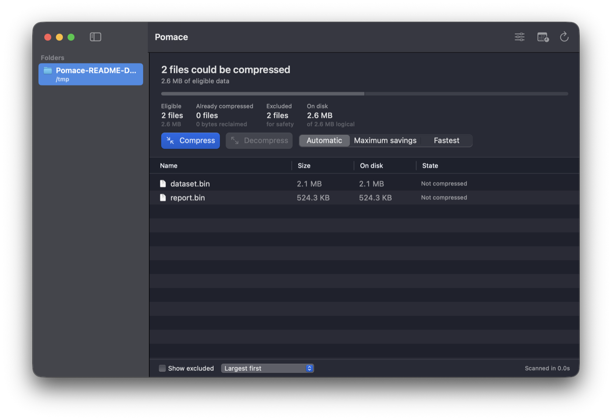
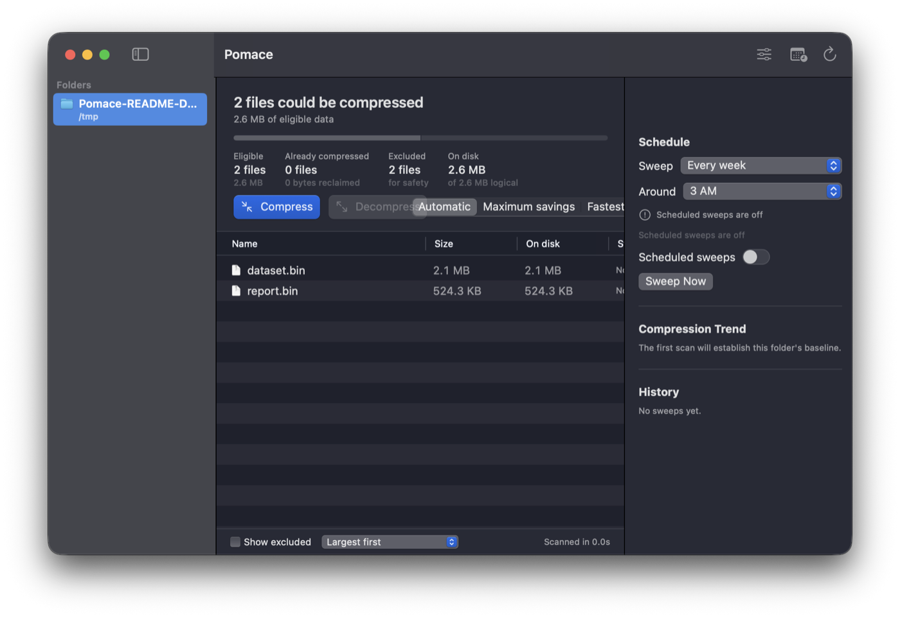

# Pomace

**Transparent filesystem compression for macOS, with a native UI and a memory.**

> *Pomace* is the dense solids left behind after apples are pressed.

Pomace is a native macOS app for inspecting, applying, and maintaining APFS/HFS+
transparent compression. It scans a folder before changing it, makes the current state
legible file by file, and can revisit watched folders to recover space that returns as
files are written over time.

Compressed files continue to open normally in Finder and every other app. There is no
archive to mount, extract, or manage: macOS transparently expands the data when it is
read.

**Languages:** English, 简体中文, Español, 日本語, 한국어, Deutsch, Français, and Português (Brasil).
Translations are machine-made; [corrections are welcome](docs/TRANSLATING.md).



## What Pomace Does

- **Scan first.** See eligible, already-compressed, and safety-excluded files before any
  mutation happens.
- **Compress and decompress.** Use guided modes for automatic behavior, maximum savings, or
  fastest processing. Every compression is verified, and decompression is a first-class,
  confirmed action.
- **Keep folders compressed.** Add a schedule and Pomace will re-sweep watched directories,
  recording the outcome and explaining when macOS conditions defer a run.
- **Explain its choices.** The advanced settings view exposes the compression plan and the
  reasoning behind it without making flags the default experience.



## A Note on "Transparent"

This is filesystem compression, not archival compression. Pomace never creates a private
file format and it never writes `decmpfs` attributes directly. It uses
[`applesauce`](https://github.com/Dr-Emann/applesauce) to ask macOS to apply transparent
compression to a file already on disk.

The important tradeoff is that writing to a compressed file may cause macOS to expand it
again. That is normal behavior, and it is why Pomace can watch a folder and rescan it on a
schedule.

## Safety

Pomace is deliberately cautious:

- A scan is read-only. Compression and decompression only begin from an explicit action.
- Compression is verified and the app re-scans through its native detector after a run.
- Unsafe or unhelpful content is excluded with a visible reason.
- Decompression names the affected file count and requires confirmation.
- The scheduled worker defers when system conditions make background I/O a bad citizen.

Read the [safety rules](docs/SAFETY.md) before using Pomace on data you cannot replace.

### Protected Homebrew and application files

When scanning `/Applications`, `/opt/homebrew`, or `/usr/local` (or a folder inside one
of them), enable **Use administrator privileges** before compressing or decompressing
protected files. Pomace confirms the selected folder, scanned file count, and exact
compressor path. macOS handles administrator authorization; Pomace never asks for or
stores your password. Long runs may require authorization again for a later batch or cleanup.

Administrator access is only used for folders that only administrators can change.
Every directory in the path must be root-owned, with no group/world write permission,
ACLs or symlinked components. Pomace checks this before authorization and again before
mutation. Root-owned files under user-owned or writable parents are refused, including
many Homebrew installations; owning the file alone is insufficient. This prevents
another process running as you from swapping a directory after the safety check.

The confirmation is bound to the compressor's SHA-256. Changed executable bytes are
refused; elevated batches use a checked root-owned private copy that is removed at the
end. A custom compressor still receives the administrator access you explicitly grant
it, so choose only an executable you trust. See ADR-0016 for the cleanup and trust limits.

Only the compressor runs with elevated access. Scans, the app, and scheduled sweeps keep
running as your normal user. This option does not bypass safety exclusions, macOS privacy
controls, or a read-only volume. Mac App Store and Adobe applications remain excluded.
Stop lets the active batch finish safely; cancel the macOS authorization dialog to stop
before that batch starts.

## Requirements

- macOS 14 Sonoma or later
- Apple silicon or Intel Mac
- APFS or HFS+ volume

Pomace includes a pinned [`applesauce`](https://github.com/Dr-Emann/applesauce) compressor;
Homebrew and a separate compressor installation are not required. Settings → Advanced →
Compressor shows its source, version and path. Choose… selects a custom applesauce executable;
Use Bundled clears that override. Pomace checks the chosen executable before every run and
falls back to its checked bundled copy if the custom choice becomes unusable, with the
reason shown in Advanced. If neither is usable, Pomace still scans and explains files
while compression and decompression stay disabled. Standard macOS privacy controls apply to locations such as Desktop, Documents,
Downloads, external volumes, and network shares.

## Install and Build

Download the notarized `.dmg` from the
[GitHub Releases page](https://github.com/sdelavega/Pomace/releases), open it, and drag
`Pomace.app` to Applications. The 1.1 app is universal: it runs on Apple silicon and
Intel Macs, removing 1.0.2's Apple-silicon-only limitation.

Or install with Homebrew:

```bash
brew install --cask sdelavega/tap/pomace
```

Starting with 1.1, Sparkle checks for updates automatically. Use Pomace → Check for
Updates… or change automatic checks in Settings → General. Updates wait for active
compression and decompression runs to finish before relaunching. Users of 1.0.2 need
to install 1.1 manually once; subsequent updates use the built-in updater.

To build from source, install Swift 6 with the macOS SDK, Rust stable with the
`aarch64-apple-darwin` and `x86_64-apple-darwin` targets, and `cargo-deny` for the full
gate (`cargo install --locked cargo-deny`). Keep `~/.cargo/bin` ahead of Homebrew on
PATH and use `RUSTUP_TOOLCHAIN=stable`. The first build downloads the pinned Sparkle
and Cargo dependencies. Then:

```bash
swift test
./build-app.sh debug
open build/Pomace.app
```

The assembled application is signed when the configured local Developer ID identity is
available; otherwise the script makes an ad-hoc development build. Release packaging and
notarization are documented in [release/README.md](release/README.md).

## Project Status

Pomace 1.1 implements the bundled compressor, universal app, Sparkle updates,
notarized DMG pipeline, eight interface languages, accessibility improvements, and
Help → Report a Problem. Diagnostics are user-initiated: review a redacted report,
then copy, save, or open a GitHub issue; nothing is uploaded automatically. CI runs
the same gate as local development, including a release dry-run without secrets.
The 1.1 release still needs the clean-account, local-update, VoiceOver/keyboard,
locale-screenshot and Intel Mac checks listed in the [roadmap](docs/ROADMAP.md).

## Technical Notes

| Document | Contents |
| --- | --- |
| [Product requirements](docs/PRD.md) | Scope, users, constraints, and non-goals |
| [Architecture](docs/ARCHITECTURE.md) | Process model, scan engine, persistence, and scheduling |
| [Safety](docs/SAFETY.md) | Exclusions and operational invariants |
| [Decisions](docs/DECISIONS.md) | ADRs and their tradeoffs |
| [Defaults](docs/DEFAULTS.md) | Automatic compression policy |
| [M2 findings](docs/M2-FINDINGS.md) | The afsctool hard-link data-loss bug that prompted the move to applesauce |
| [Roadmap](docs/ROADMAP.md) | Milestones and remaining release work |

## License

Pomace is available under the [GNU General Public License, version 3 or later](LICENSE).
The bundled `applesauce` compressor is GPL-3.0 and runs as a separate process.
Its source is available at [Dr-Emann/applesauce](https://github.com/Dr-Emann/applesauce);
Pomace's pinned wrapper, dependency lockfile and build instructions are in
[tools/applesauce](tools/applesauce/README.md). The About panel includes the credit and
source link.
